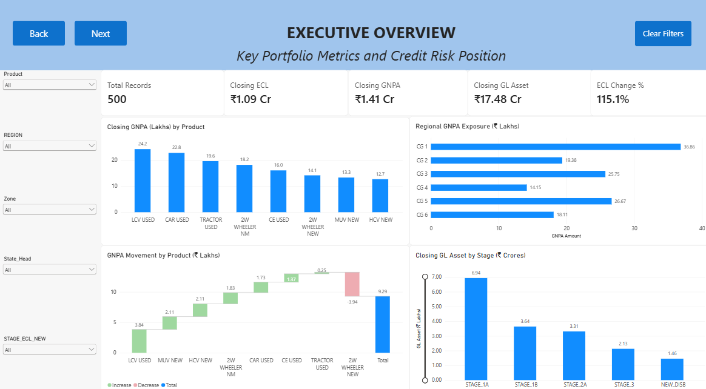
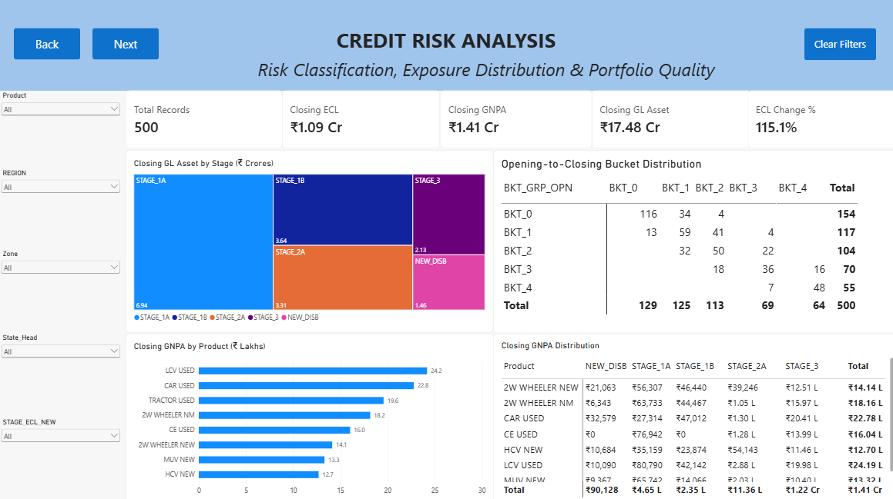
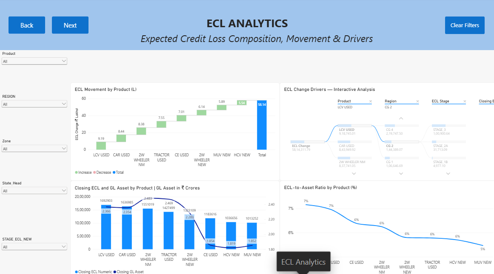
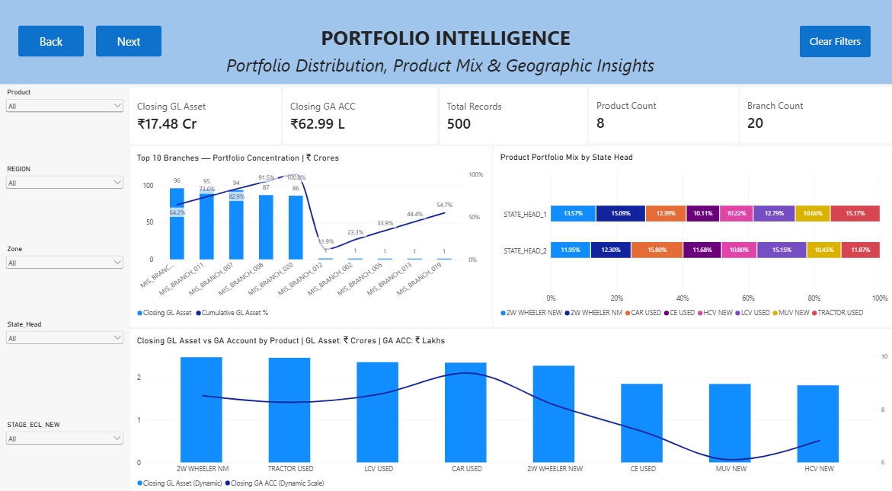
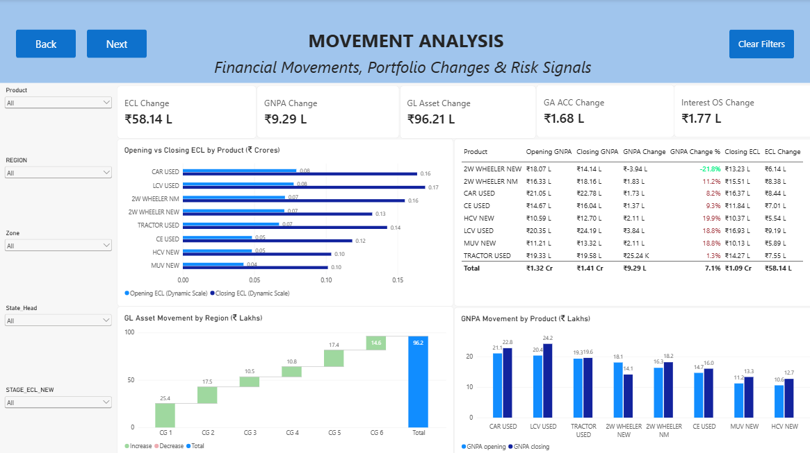

# ECL & Credit Risk Analytics Dashboard | Power BI

An interactive Power BI report for exploring expected credit loss (ECL), gross non-performing assets (GNPA), asset exposure, portfolio composition, and opening-to-closing movements across products, regions, branches, and stage classifications.

> **Data disclaimer:** This project uses a synthetic demonstration dataset. It is not actual company, customer, or operational data. Some field abbreviations and stage/bucket meanings are unverified and should not be given official business or regulatory interpretations without authoritative documentation.

## Dashboard Preview

### Executive Overview

### Credit Risk Analysis

### ECL Analytics

### Portfolio Intelligence

### Movement Analysis

## Project Objectives

- Monitor closing ECL, GNPA, and GL Asset measures.
- Compare financial positions between opening and closing periods.
- Explore ECL and GNPA movements by product and region.
- Analyse portfolio distribution across stage and bucket classifications.
- Review branch concentration and product mix across organisational categories.
- Support interactive investigation through slicers, matrices, waterfall charts, treemaps, and a decomposition tree.

## Tools

- **Power BI Desktop** — report authoring, data modelling, and visualisation.
- **Power Query** — data preparation and transformation.
- **DAX** — measures, movement calculations, ratios, and dynamic titles/unit selection.
- **Microsoft Excel** — source workbook.
- **GitHub** — project documentation and version control.

## Dataset

`ECL_Credit_Risk_Dummy_Data_500.xlsx` contains 500 synthetic records and 46 columns. Its sheets are `Dummy_Data`, `Data_Dictionary`, and `Read_Me`.

The data includes opening/closing ECL and GNPA values, GL Asset measures, GA ACC and interest-outstanding fields, product categories, branches, regions, zones, State Heads, and synthetic stage/bucket categories. The definitions of some abbreviations are explicitly unverified in the workbook; validate them before using the measures for business decisions.

## Dashboard Pages

### 1. Executive Overview
High-level KPI cards and charts for closing ECL, GNPA, GL Asset, ECL percentage change, regional GNPA, product-level GNPA movement, and GL Asset by stage.

### 2. Credit Risk Analysis
Stage-level exposure, opening-to-closing bucket distribution, GNPA by product, and product-by-stage GNPA analysis.

### 3. ECL Analytics
Product-level ECL movement, a decomposition tree for exploring ECL change, closing ECL compared with GL Asset, and an ECL-to-asset ratio by product.

### 4. Portfolio Intelligence
Portfolio KPI cards, top-branch concentration, product mix by State Head, and GL Asset versus GA ACC by product.

### 5. Movement Analysis
Opening-to-closing changes in ECL, GNPA, GL Asset, GA ACC, and Interest OS, with product and regional breakdowns.

## Key Power BI Features

- Interactive slicers for product, region, zone, State Head, and stage classification.
- KPI cards for summary reporting.
- Waterfall charts to show category contributions to movements.
- Treemap and matrix visuals for portfolio distribution and opening/closing classification comparisons.
- Decomposition tree for interactive breakdown of ECL change.
- Combination charts and a 100% stacked bar chart for comparing measures and portfolio mix.
- Dynamic titles and adaptive unit selection (thousands, lakhs, crores) where implemented.
- Page navigation and filter reset controls.

## Analytical Questions

- Which products and regions contribute the largest GNPA amounts?
- How is closing GL Asset distributed across the available stage categories?
- How do opening and closing bucket classifications compare?
- Which products contribute to ECL movement?
- How does ECL compare with GL Asset across products?
- How does product mix vary across State Heads?
- Which regions contribute most to GL Asset movement?

These visuals support descriptive exploration; they do not independently prove causation or predict future defaults.

## Limitations

- The dataset is synthetic and results are illustrative only.
- Certain source-field abbreviations and stage/bucket definitions remain unverified.
- Results depend on the correctness of the data model, DAX measures, relationships, filter interactions, and unit conversions.
- Validate cumulative branch concentration calculations and financial measure definitions before presenting them as business findings.
- This is a descriptive analytics dashboard, not a credit scoring or predictive modelling system.

## Author

**Badrinarayan**  
B.Tech — Computer Science and Business Systems  
Focus: Power BI, Business Intelligence, Financial Analytics, and Credit-Risk Reporting.
